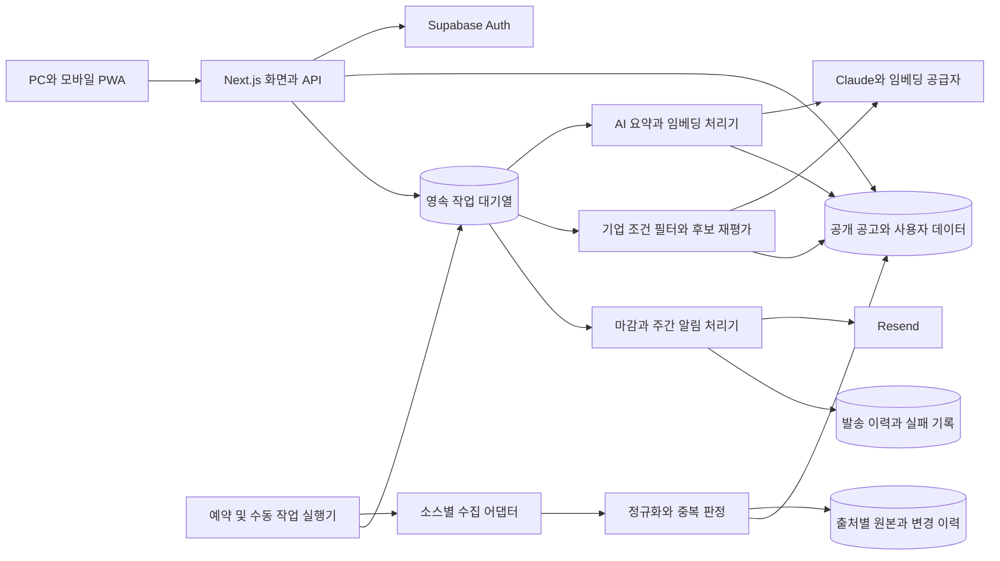

# WithBiz AI 시스템 구조와 처리 흐름

작성일: 2026-10-27 · STEP 3 설계안

## 구성



화면 조회는 저장된 결과만 읽는다. 외부 공공 API·LLM·메일 호출은 어댑터 경계에서 실행하며, 공개 화면을 열었다는 이유로 비용이 발생하는 AI 작업을 시작하지 않는다.

## 모노레포 구조

아래는 STEP 4에서 생성할 목표 구조다. 현재 해당 앱 파일이 이미 존재한다는 의미는 아니다.

```text
withbiz-ai/
  apps/web/
    app/(public)/                 대시보드, 공고 목록·상세
    app/(auth)/                   로그인, 가입, 복구, OAuth 콜백
    app/(member)/                 추천, 관심, 캘린더, 기업, 알림
    app/admin/                    수집·공고·사용자 통계
    app/api/v1/                   버전이 있는 API
    components/ui/                공통 버튼·입력·카드
    components/features/          공고·지도·매칭·캘린더
    lib/supabase/                 브라우저·서버·운영 전용 클라이언트
    lib/repositories/             데이터 저장소 조립
    styles/                       브랜드 토큰
    public/                       PWA 아이콘과 정적 리소스
  packages/shared/                타입, 코드표, Zod 계약, 날짜
  packages/collectors/            소스별 어댑터, 오류 분류
  packages/normalizer/            날짜, 상태, 지역, 내용 해시, 중복
  packages/ai/                    공급자 어댑터, 프롬프트, 출력 검증
  packages/matching/              필터, 벡터 후보, 재평가, 근거
  packages/notifications/         발송 대상, 중복 방지, 메일 템플릿
  packages/data/                  Supabase 저장소와 샘플 저장소
  jobs/                          수집, 작업 처리, 알림, 보관 정책
  supabase/                      로컬 설정, 마이그레이션, seed, RLS 테스트
  tests/                         단위, 소스 계약, 통합, 브라우저 E2E
  docs/                          요구사항, 설계, 연결·운영 안내
  .github/workflows/             CI와 작업 실행
```

패키지 의존성은 shared → 도메인 패키지 → jobs/web 순서로 둔다. 도메인 로직이 Next.js 화면을 import하지 않게 한다. 앱은 저장소 인터페이스를 사용해 샘플과 연결 모드를 같은 API 계약으로 조회한다.

## API 연결을 미룬 개발 방식

| 모드 | 데이터·인증 | 외부 호출 | 화면 표시 |
| --- | --- | --- | --- |
| 샘플 | 명시된 fixture와 시연용 사용자, 임시 저장은 해당 브라우저 범위 | 수행하지 않음 | 모든 화면에 “샘플 데이터 · 기준일” 표시. AI 결과도 시연용으로 표시 |
| 연결 | Supabase 실제 세션과 저장된 공고 | 승인·설정된 작업에서만 수행 | 마지막 성공 기준일, 소스별 상태, AI 생성 상태 |

샘플 모드의 관심·프로필 변경은 개인 브라우저 저장소에서 동작하도록 설계한다. 서버 전체가 공유하는 전역 가짜 사용자 상태는 두지 않는다. 샘플 관리자 화면은 운영 권한을 부여하지 않으며 “시연 화면”으로 표시한다. 로그인 공급자·메일 공급자가 없으면 실제 가입이나 발송이 된 것처럼 성공 메시지를 출력하지 않는다.

연결 모드에서 DB 설정이 없거나 인증에 실패하면 설정 필요·연결 오류를 표시한다. 자동으로 샘플로 전환하지 않는다. 수집 소스 활성화는 별도 플래그로 관리해 기업마당만 연결하는 단계도 가능하게 한다. 배포 환경의 샘플 모드는 명시적 시연 배포에만 허용한다.

샘플 날짜는 fixture의 referenceDate로 고정하고 D-day 옆에도 “샘플 기준일 기준”을 표시한다. 실제 시각과 섞어 현재 접수 중인 사업처럼 보이게 하지 않는다. 실제 API에서 수신한 4건은 계약 검증 fixture로만 보관하고 현재 모집 공고를 대신하지 않는다.

## 수집과 공고 변경

1. 실행기가 소스별 잠금을 획득하고 collection_run을 생성한다. 활성 소스만 호출한다.
2. fetchList → fetchDetail(필요한 소스만) → toRaw 공통 인터페이스로 원본을 가져온다. 마지막 페이지, 총건수, 상한에 따른 중단 사유를 기록한다.
3. source_id·external_id로 출처 레코드를 식별한다. 제목·기관·신청 마감일 기반 해시는 소스 간 중복 후보 탐지에 사용하며 유일 제약으로 강제하지 않는다.
4. 갱신 시 비교할 내용 해시에서 조회수·실행 시각·HTML 표현 차이 등을 제외한다. 원본 변경과 지원내용 변경을 구분한다.
5. 대표 공고와 출처 연결을 트랜잭션으로 반영한다. 변경된 공개 데이터 버전을 올려 목록 커서를 갱신한다.
6. 신규·지원내용 변경만 AI 작업으로 등록한다. 마감 변경은 추천 무효화·예약 취소·변경 알림 대상 생성까지 연결한다.
7. 부분 실패면 기존 정상 데이터를 유지하고 기준일과 소스 실패를 표시한다. 0건이면 자동 대량 삭제·마감을 수행하지 않는다.

원본 HTML은 그대로 화면에 삽입하지 않는다. 정제한 텍스트를 기본으로 사용하고, 링크·첨부는 HTTPS와 허용 호스트·응답 형식을 검증한다. 첨부 오류는 본문 요약을 막지 않되 “첨부 미확인”을 AI 입력과 사용자 안내에 남긴다.

## 비동기 작업과 재매칭

기업 저장 트랜잭션은 profile_version을 올리고 processing_jobs에 고유한 매칭 작업을 등록한다. API는 202와 작업 ID를 반환한다. 저장 직후 실행기 호출은 시도하되 실패해도 작업이 DB에 남는다. 별도 주기 실행기가 대기 작업과 만료된 lease를 회수한다.

수집은 GitHub Actions 예약 06:00 KST를 기본으로 한다. 사용자 변경 작업은 workflow_dispatch 등 즉시 실행 경로와 주기 회수 경로를 함께 설계한다. GitHub 저장소 연결 전에는 로컬 실행기가 같은 작업 처리 코드를 실행한다. 실제 배포에서 어떤 깨우기 경로를 사용할지는 연결 시 확정한다. 목표는 저장 즉시 접수, 보통 2분 이내 처리 시작이며 실행기 대기시간을 포함해 보장된 수치로 주장하지 않는다.

작업은 queued → running → succeeded / failed / blocked 상태를 가진다. 잠금은 만료시간을 갖고 처리 중 heartbeat로 갱신한다. 재실행은 같은 idempotency_key를 사용한다. 작업 완료 시 예상 profile_version·announcement_revision과 현재 값을 비교해 오래된 결과가 새 결과를 덮어쓰지 못하게 한다. 오래된 작업은 superseded로 종료하고 최신 버전을 다시 처리한다.

## 3단계 매칭

1. 자격 조건을 항목별 충족·미충족·확인 필요로 판정한다. 명백한 미충족만 제외한다. 원문에서 확인되지 않은 정보는 추정해서 탈락시키지 않는다.
2. 같은 임베딩 모델·차원의 공고와 기업 벡터로 후보를 정렬한다. 모델이 다르면 비교하지 않는다. 후보 상한은 100건을 초기값으로 둔다.
3. 상위 20건 중 캐시가 없거나 공고·기업·프롬프트 버전이 달라진 후보만 LLM 재평가한다. 예산에 맞춰 나누어 처리하며 “상위 20건”을 매일 전량 재호출한다는 뜻으로 구현하지 않는다.

점수 0~100, 추천 사유 2~3개, 확인 조건, 제외 근거, 버전과 시각을 저장한다. 모델 미연결·출력 검증 실패 시 실제 적합도 점수를 생성하지 않는다. 임베딩만 가능한 경우에는 의미 유사도임을 구분하며 LLM 적합도처럼 표시하지 않는다.

Claude·임베딩 공급자에 기업명·대표자명·이메일·사업자번호를 전달하지 않는다. 지역·업력·업종·규모 등 판정에 필요한 최소 항목만 전송한다. 문서 내용 안의 지시문은 분석 데이터로 취급하고 실행하지 않는다.

## 알림

매일 08:00 KST에 D-7·D-3·D-1과 공고 변경을 사용자별 하루 한 통으로 묶는다. 주간 요약은 월요일 08:00에 발송한다. 이미 그날 보낸 사용자에게 당일 항목을 추가하지 않고 다음 실행 기준을 적용한다. 긴급 변경 알림의 추가 발송 허용 여부는 알림 설정에서 별도 확인한다.

대상 생성과 발송 작업을 분리하고 알림 항목·메일 묶음 각각에 중복 방지 키를 둔다. 공급자의 성공 응답·메시지 ID를 기록한다. 타임아웃으로 발송 여부가 불명확하면 unknown으로 두고 상태 조회·서명 검증된 webhook으로 확인한다. 공급자 idempotency 지원과 보존기간은 연결 시 검증하며, 무조건 재발송하지 않는다.

## 운영 경계와 최신 문서 확인

Next.js 공개 조회와 회원 조회 캐시를 분리한다. 사용자 응답·세션 갱신 응답은 공유 CDN에 저장하지 않는다. 인증은 검증된 세션을 사용하고 관리자 역할은 서버 전용 테이블에서 매 요청 확인한다. [Supabase SSR 공식 안내](https://supabase.com/docs/guides/auth/server-side/creating-a-client?queryGroups=framework&framework=nextjs)

2026-10-27 changelog를 확인했다. 새 프로젝트에는 ltree·btree_gist·레거시 pgcrypto 암호화를 기본으로 넣지 않으며, 실제 DB 연결 후 설치 버전을 검사한다. [관련 DB 변경 안내](https://supabase.com/changelog/postgres-15-19-17-11-breaking-changes)

TLS 변경에 맞춰 지원 중인 최신 브라우저·Node LTS를 대상으로 한다. 오래된 OS 지원은 별도 검증 범위다. [TLS 변경 안내](https://supabase.com/changelog/cbc-tls-ciphers-deprecated)

JS 패키지는 구현 시 검증한 버전과 lockfile을 고정한다. Supabase 확장은 플랫폼 기본 버전을 사용하며 설치된 실제 버전을 기록한다. [확장 버전 정책](https://supabase.com/changelog/extension-version-pinning-ignored)
