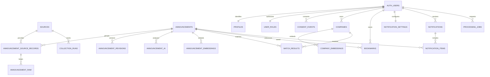

# WithBiz AI 데이터베이스와 접근 권한 설계

작성일: 2026-10-27 · STEP 3 설계안 · DB 미생성, SQL 미적용

## 모델링 기준

사용자가 보는 대표 공고와 소스별 공고를 분리한다. 기존 계획의 `(source_id, external_id)` 유일성은 출처 레코드에 적용하고 대표 공고는 여러 출처를 가질 수 있게 한다. 중기부와 기업마당 중첩을 처리하면서 출처·원본·변경 이력을 보존하기 위한 설계 보완이다.

인증은 Supabase의 auth.users를 사용하며 비밀번호를 앱 테이블에 저장하지 않는다. 공개 화면용 데이터와 기업 소유 데이터는 public에 두고 원본·운영 설정·권한·작업 대기열은 노출하지 않는 private 스키마에 둔다. 모든 노출 테이블은 RLS와 필요한 GRANT를 함께 정의한다. [Supabase RLS 안내](https://supabase.com/docs/guides/database/postgres/row-level-security)

## 핵심 관계

AUTH_USERS는 auth.users를 뜻한다. USER_ROLES·ANNOUNCEMENT_RAW·ANNOUNCEMENT_REVISIONS·임베딩·COLLECTION_RUNS·PROCESSING_JOBS·CONSENT_EVENTS는 private 스키마에 속한다. 나머지는 public이다. ERD에는 주요 관계를 표시했고 감사 로그 등은 아래에서 정의한다.

## 테이블 정의

공통: PK는 별도 명시가 없으면 UUID, 생성·수정 시각은 timestamptz, 날짜만 알려진 값은 date다. 필수 항목은 아래에서 NN으로 표시한다. 이름과 상태 코드는 shared의 검증 스키마와 일치시킨다.

### 공고와 출처

| 테이블 | 핵심 컬럼 | 무결성 |
| --- | --- | --- |
| public.sources | id, code NN, name NN, homepage_url NN, is_active NN, last_success_at | code 유일. 비밀키·개인 메일·내부 오류 원문 없음 |
| public.announcements | id, title NN, agency NN, operator, category NN, fields text[] NN, regions text[] NN, region_estimated NN, primary_source_id NN, primary_url NN, content_text, apply_start date, apply_end date, apply_end_at timestamptz, deadline_kind NN, deadline_text, source_created_at, collected_at NN, updated_at NN, revision NN, content_hash NN, dedup_hash NN, visibility NN | primary_source_id FK sources. 날짜 역전 금지. visibility=published/hidden/merged. revision 양수 |
| public.announcement_source_records | id, source_id NN, external_id NN, announcement_id NN, original_url NN, source_updated_at, first_seen_at NN, last_seen_at NN, content_hash NN | unique(source_id, external_id). announcement_id FK. 같은 공고의 소스별 원문 링크 보존 |
| private.announcement_raw | id, source_record_id NN, collection_run_id NN, payload jsonb NN, payload_hash NN, fetched_at NN | FK source_records·collection_runs. 원본 내용과 수집 이력 보관 |
| private.announcement_revisions | announcement_id NN, revision NN, normalized_snapshot jsonb NN, changed_fields text[] NN, created_at NN | 복합 PK(announcement_id, revision). 변경 전후 비교·감사 |
| public.announcement_ai | id, announcement_id NN, announcement_revision NN, summary jsonb NN, eligibility jsonb NN, confidence numeric NN, model NN, prompt_version NN, input_hash NN, processing_status NN, created_at NN | unique(announcement_id, announcement_revision, model, prompt_version). confidence 0~1. 현재 공개된 공고만 사용자 조회 |
| private.announcement_embeddings | announcement_id NN, announcement_revision NN, model NN, dimensions NN, input_hash NN, embedding vector(d) NN, created_at NN | 복합 PK(announcement_id, announcement_revision, model). 차원 d는 모델 선정 시 확정 |
| private.source_configs | source_id PK, enabled NN, endpoint NN, credential_env_name NN, rate_limit_config jsonb, license_status NN, retry_config jsonb | 비밀값은 환경 변수. 환경 변수 이름과 허용 엔드포인트만 저장 |

상태는 일 단위로 달라지므로 오래된 status 문자열을 진실의 원천으로 두지 않는다. source 모집 상태·관리자 조기 종료·시작일·마감일·정확한 종료 시각을 공유 날짜 함수에 전달해 API가 asOf 기준으로 계산한다. deadline_kind는 fixed/open/budget_exhausted/unknown이다. 고정일이 없으면 D-day를 계산하지 않는다. apply_end_at과 apply_end가 모두 있으면 한국 날짜 일치 제약을 적용한다.

지역·분야는 코드표 검증을 거친 배열로 저장한다. 빈 지역 배열과 전국 공통 코드를 구분한다. 배열 GIN 인덱스를 쓰되 코드 검증은 서버와 DB 쓰기 경계에 함께 둔다. 국가 지도는 공고 수가 아닌 지역별 출현 수를 나타내므로 합계 차이를 설명한다.

### 회원과 기업

| 테이블 | 핵심 컬럼 | 무결성 |
| --- | --- | --- |
| public.profiles | user_id PK/FK auth.users, name NN, created_at NN, updated_at NN | 역할을 포함하지 않는다. 이름 수정 허용 |
| private.user_roles | user_id PK/FK auth.users, role NN, disabled_at, updated_at NN | role=user/dealer/admin. 사용자 직접 쓰기 금지. dealer는 MVP 권한 확대 없음 |
| private.consent_events | id, user_id NN, consent_type NN, document_version NN, accepted NN, occurred_at NN | 약관·개인정보·마케팅 동의와 철회 이력. 가입·동의 API만 기록 |
| public.companies | id, owner_id NN, name NN, biz_type NN, size NN, ksic_codes text[] NN, sido NN, sigungu, founded_on, revenue_band, employees, owner_traits text[] NN, certifications text[] NN, interests text[] NN, needs text[] NN, profile_version NN, created_at NN, updated_at NN | owner_id FK auth.users. employees>=0. profile_version 양수. owner_id 변경 불가 |
| private.company_embeddings | company_id NN, profile_version NN, model NN, dimensions NN, input_hash NN, embedding vector(d) NN, created_at NN | 복합 PK(company_id, profile_version, model). 모델별 차원 검증 |
| public.match_results | id, company_id NN, announcement_id NN, company_version NN, announcement_revision NN, algorithm_version NN, score, eligibility_status NN, reasons jsonb NN, unmet_or_unknown jsonb NN, result_status NN, generated_at NN | 해당 버전·알고리즘 조합 유일. score는 null 또는0~100. 명백한 미충족은 제외 표시 |
| public.bookmarks | user_id NN, announcement_id NN, memo NN, created_at NN, updated_at NN | 복합 PK(user_id, announcement_id). memo 최대2,000자 |

대표자 특성·매출 구간은 선택 항목으로 둔다. 최소 프로필은 기업명·사업자 유형·규모·지역·업종이며 추천 완성도를 별도 표시한다. founded_on 등 누락을 0년·0원으로 치환하지 않는다. MVP UI는 주 기업 1개로 시작하고 DB에는 복수 기업을 허용한다. 고객사 위임·공유 권한은 구현하지 않는다.

### 알림과 운영

| 테이블 | 핵심 컬럼 | 무결성 |
| --- | --- | --- |
| public.notification_settings | user_id PK, email_enabled NN, deadline_offsets smallint[] NN, weekly_enabled NN, change_enabled NN, timezone NN, updated_at NN | offsets는7·3·1의 중복 없는 부분집합. timezone 기본 Asia/Seoul |
| public.notifications | id, user_id NN, kind NN, delivery_date NN, status NN, idempotency_key NN, provider_message_id, scheduled_at NN, sent_at, last_error_code | idempotency_key 유일. queued/sending/sent/failed/unknown/cancelled. 고객에 공급자 원문 오류 노출 없음 |
| public.notification_items | id, notification_id NN, announcement_id, announcement_revision, item_kind NN, deadline_date, dedup_key NN | dedup_key 유일. 관심 해제·일정 변경 시 미발송 항목 취소 |
| private.collection_runs | id, source_id NN, status NN, started_at NN, finished_at, fetched_count NN, new_count NN, changed_count NN, failure_code, sanitized_error, coverage jsonb | 건수>=0. 인증 오류와 0건 경고 구분. 실행키 유일 |
| private.processing_jobs | id, kind NN, user_id, company_id, announcement_id, payload jsonb NN, idempotency_key NN, state NN, attempts NN, available_at NN, lease_until, heartbeat_at, created_at NN | idempotency_key 유일. 상태 전이는 서버만 수행. 사용자에게는 안전한 작업 투영만 반환 |
| private.audit_logs | id, actor_user_id, action NN, target_type NN, target_id, before jsonb, after jsonb, request_id NN, created_at NN | 변경 불가 로그. 비밀키·세션·원문 개인정보 제거 |
| private.catalog_state | singleton_id PK, version bigint NN, updated_at NN | 공개 데이터 변경 트랜잭션에서 증가. 오래된 목록 커서 감지 |
| private.internal_request_nonces | nonce PK, received_at NN, expires_at NN | 내부 작업 서명 재사용 차단. 만료 행 주기 삭제 |

notifications 조회는 본인만 가능하고 상태 변경은 서버만 가능하다. 관심이 사라졌거나 사용자 알림 설정이 꺼진 경우 발송 직전에 다시 확인한다. 수신 이메일은 Auth의 검증된 주소를 서버에서 조회하고 임의 입력 주소로 보내지 않는다.

## 인덱스와 검색

| 대상 | 인덱스 설계 | 용도 |
| --- | --- | --- |
| announcements | published 조건의 (apply_end, id), (source_created_at DESC, id DESC) | 마감순·최신순 커서 |
| announcements | category, primary_source_id의 B-tree, fields·regions의 GIN | 유형·출처·지역·분야 필터 |
| announcements | 정규화 검색 텍스트의 pg_trgm GIN | 한국어 부분 문자열 검색. 짧은 검색어와 광범위 검색은 실행시간 제한 적용 |
| source_records | unique(source_id, external_id), (announcement_id), (source_id, source_updated_at) | upsert·출처 목록·증분 수집 |
| companies | (owner_id, id) | 소유자 RLS와 기업 목록 |
| match_results | (company_id, company_version, score DESC NULLS LAST, announcement_id), (announcement_id) | 추천 목록과 변경 무효화 |
| bookmarks | PK, (announcement_id) | 내 관심 조회·공고 변경 대상 |
| notifications | (user_id, created_at DESC), 미발송 상태의(scheduled_at, id) | 이력·발송 대기 |
| processing_jobs | 처리 가능 상태의(available_at, id), (company_id), (user_id) | 작업 claim·본인 작업 조회 |
| revisions·raw·runs | 참조 FK와 시간 컬럼 | 이력 조회와 보관 정책 |

pg_trgm의 한국어 부분 검색 품질은 STEP 4에서 실데이터로 확인한다. 벡터 검색은 모델 선정 전 차원을 임의 확정하지 않는다. 초기 데이터는 정확 검색으로 시작하고 규모·응답시간 측정 후 같은 모델·차원별 HNSW 인덱스를 추가한다. 자격·지역 필터와 벡터 검색을 함께 적용했을 때 후보가 부족해지는지도 테스트한다.

## 권한 행렬

| 데이터 | 비회원 | 회원 본인 | 다른 회원 | 관리자 화면 | 작업 실행기 |
| --- | --- | --- | --- | --- | --- |
| 공개 공고·출처·현재 AI | 읽기 | 읽기 | 읽기 | 읽기·서버 수정 | 쓰기 |
| 숨김 공고·원본 | 불가 | 직접 읽기 불가 | 불가 | 필요한 범위 서버 조회 | 읽기·쓰기 |
| 기업·프로필 | 불가 | 읽기·허용 항목 수정 | 불가 | 통계 원칙, 개인정보 조회 별도 | 매칭에 필요한 최소 읽기 |
| 관심·설정 | 불가 | 읽기·생성·수정·삭제 | 불가 | 임의 수정 불가 | 알림 처리에 필요한 읽기 |
| 추천·발송 이력 | 불가 | 읽기 | 불가 | 비식별 집계 | 생성·갱신 |
| 권한·작업·감사 | 불가 | 본인 작업 상태 API만 | 불가 | 서버 검증 후 필요한 작업 | 작업별 최소 권한 |

프로필 표시 이름 수정 권한과 관리자 역할 수정 권한을 분리한다. user_metadata나 사용자가 전송한 role을 권한 판단에 사용하지 않는다. 관리자도 브라우저에 service key를 받지 않는다.

RLS 조건 설계:

- profiles·bookmarks·notification_settings: 인증 user_id와 행 소유자가 같아야 한다. update는 USING과 WITH CHECK 모두 소유자 일치를 검사한다.
- companies: owner_id가 인증 사용자와 같아야 한다. owner_id와 profile_version 등 서버 관리 컬럼은 직접 수정 GRANT에서 제외한다.
- match_results: 참조 기업의 owner_id와 인증 사용자가 같아야 읽을 수 있다. 다른 기업 ID를 URL에 넣으면 데이터가 나오지 않는다.
- notifications·notification_items: notifications.user_id를 통해 본인만 읽는다. 직접 insert·update 권한을 부여하지 않는다.
- announcements·source_records·announcement_ai: 연결된 대표 공고가 published인 경우에만 공개 읽기. 과거 AI 버전은 현재 revision과 일치하는 공개 투영에서만 노출한다.
- 관심 등록: 본인 소유권과 대상 공고의 공개 상태를 함께 검사한다. 이후 숨김 처리된 기존 관심은 공고 본문 없이 “공개 중지된 공고” 상태만 API가 반환한다.

private 스키마는 Data API에 노출하지 않고 anon·authenticated의 접근·함수 실행 권한을 제거한다. API가 받아들인 사용자 ID를 믿고 service key로 대신 조회하는 구현을 피한다. 회원 데이터 쿼리는 검증된 사용자 컨텍스트와 RLS를 사용한다. 소유권 확인 후 서버 관리 컬럼을 갱신해야 하는 트랜잭션만 범위를 제한한 서버 경로로 수행한다.

공개 뷰를 만드는 경우 security_invoker를 적용하며, 컬럼 GRANT까지 포함해 직접 테이블 호출도 테스트한다. 권한 문제를 해결하려고 공개 SECURITY DEFINER 함수나 서비스 키 우회를 추가하지 않는다. [뷰 보안 공식 문서](https://supabase.com/docs/guides/database/views)

## 마이그레이션 계획

구현 단계에서 Supabase CLI 도움말·버전을 확인하고 명령으로 마이그레이션 파일을 생성한다. 아직 파일명을 타임스탬프로 만들어 놓거나 DB에 적용하지 않았다.

1. core_extensions_and_codes: 스키마·필요 확장·코드표.
2. announcement_catalog: 대표 공고·출처·이력·AI 메타데이터.
3. members_and_consents: 프로필·역할·기업·동의·소유권.
4. matching_and_embeddings: 모델 확정 차원, 매칭과 버전.
5. bookmarks_and_notifications: 관심·설정·예약·이력.
6. processing_and_audit: 작업·수집 로그·잠금·감사·버전.
7. grants_and_rls: 공개·본인·운영 권한, 뷰, 함수 실행 제한. 각 테이블 생성 시점에도 기본 차단을 적용하고 마지막에 필요한 권한만 연다.
8. indexes_and_query_functions: 실행 계획을 확인한 검색·커서 인덱스.

## 보관·삭제·검증

원본은 90일 후 압축 보관을 기본안으로 하고 저장 위치·보유기간을 운영 정책에서 확정한다. 공고 원문을 보관할 수 있는 조건을 소스별로 확인한다. 회원 탈퇴 시 개인 프로필·기업·관심·알림 설정과 예약·기업 임베딩을 삭제하고 관련 작업을 취소한다. 감사·발송 이력의 보유기간과 비식별 처리는 개인정보 문안 확정 시 정한다.

STEP 4 검증은 회원 A/B·비회원·관리자·작업 계정을 사용한다. A가 B 기업·관심·추천·작업을 읽거나 수정할 수 없는지, 자기 역할·owner_id를 바꿀 수 없는지, 숨김 공고·원본·private 테이블을 직접 호출할 수 없는지를 테스트한다. RLS·GRANT·제약을 실행 검증하기 전에는 보안 통과로 표시하지 않는다.
