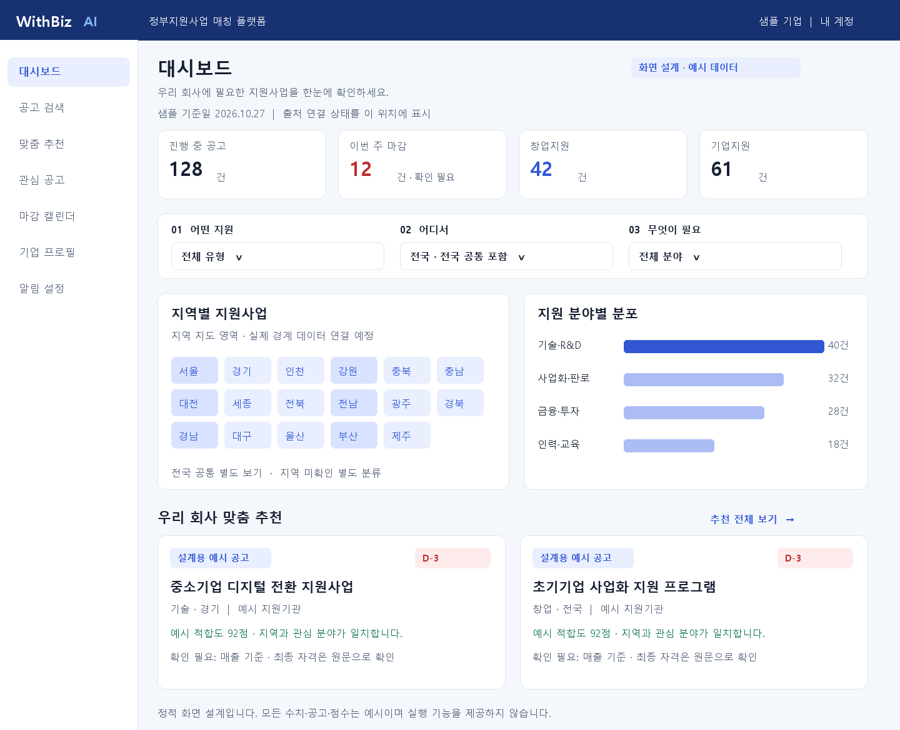
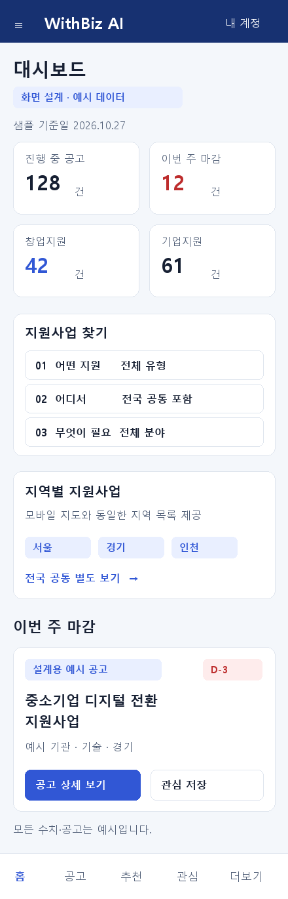
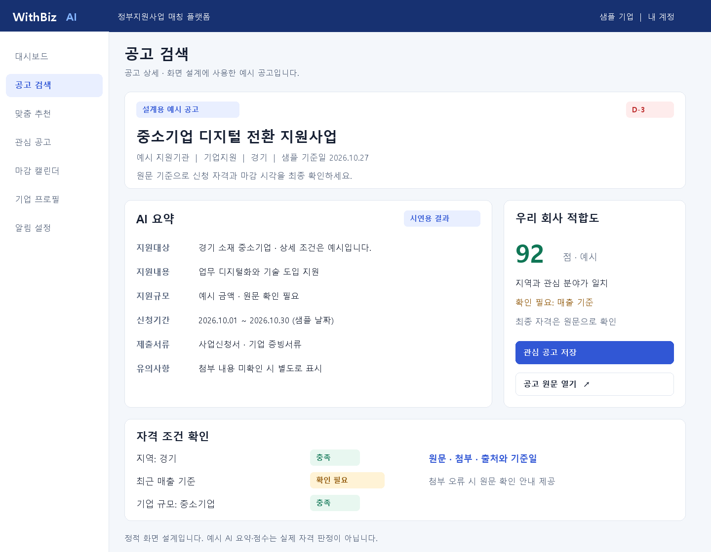

# WithBiz AI 디자인 토큰과 주요 화면 설계

작성일: 2026-10-27 · STEP 3 검토안

## 참고 화면 조사

[WithBid AI](https://choongsik-yoo.github.io/widbid/)를 실제 브라우저로 열어 CSS 변수와 계산된 스타일을 읽었다. 조사 시각은 2026-10-27 11:28 KST, viewport는1259×771이었다. [추출 원본](design/references/withbid-tokens-observed.json)을 보관했다. 화면 캡처는 시간 초과로 얻지 못했으며 아래 그림은 WithBiz 설계용 정적 와이어프레임이다.

확인한 구조는 상단 남색 헤더, 좌측 흰색 메뉴, 밝은 배경, 흰색 지표·표 패널이다. 로고는 좌측 WithBid와 밝은 파란 AI 표기다. 대시보드·공고 검색·관심 공고 같은 짧은 메뉴 명칭을 사용한다. 관찰한 화면에서 다크모드 제어는 발견하지 못했다. 앱 전체에 다크모드가 없다고 단정하지 않으며 WithBiz 1차 설계는 밝은 테마로 제안한다.

## 관찰값과 적용안

| 역할 | WithBid 관찰값 | WithBiz 적용안 |
| --- | --- | --- |
| 헤더 | #173171 | #173171 유지 |
| 주 강조 | #3157D5, hover #2446B8 | 동일 |
| 배경·패널 | #F4F7FB / #FFFFFF | 동일 |
| 본문 | #172033 | 동일 |
| 보조 글자 | 변수 #68758A, 일부 #536179 | #536179로 통일해 대비 확보 |
| 경계 | #DFE5EE | 동일. 입력 경계·포커스는 별도 강한 색 사용 |
| 메뉴 선택 | #E9EFFF / #3157D5 | 동일 |
| 성공·충족 | #12805C / #E8F7F0 | 글자 #0F7655로 어둡게 조정 |
| 주의·확인 필요 | #AD6500 / #FFF3D6 | 글자 #8C5200으로 조정 |
| 마감·미충족 | #BD2C2C / #FEECEC | 동일 |
| 서체 | Inter, Pretendard, Noto Sans KR, system-ui, -apple-system, sans-serif | 동일 계열. 한국어 글리프 포함 로컬 서체를 우선 검토 |
| 기본·표 글씨 | 기본16px, 표·공고 제목14px, 일부12px | 본문·표·입력·버튼16px 이상. 보조 배지만14~15px 허용 |
| 큰 제목 | 28px/700 | 데스크톱28~30px, 모바일26~28px |
| 헤더·사이드바 | 높이64px / 너비220px | 동일 |
| 주요 간격 | 본문 padding28px, 카드18px, gap14·18·20px | 4px 간격 토큰으로 정리. 본문28px, 카드20px, gap16·20·24px |
| 모서리 | 버튼8px, 메뉴9px, 지표 카드13px, 배지999px | 버튼8px, 메뉴9px, 카드13px. 배지는 pill 또는7px |

추출 원본은 관찰 사실이고 적용안은 제품 요구사항을 반영한 제안이다. 특히 원본 성공 색 쌍은 계산 대비4.45:1로 작은 글자 AA 기준4.5에 미달하여 조정했다. 색상 변경은 브랜드를 바꾸려는 임의 변경이 아니라 읽기 쉬운 상태 표시를 위한 보완이다.

간격 토큰은4·8·12·16·20·24·28·32·40·48px, 최소 클릭 영역44×44px다. 입력 높이는48px, 기본 버튼48px, 표 행 최소60px로 제안한다. 줄간격은 본문1.6, 제목1.35로 둔다. 포커스는 강조색 외곽선과 여백으로 표시하며 그림자만으로 표현하지 않는다.

## 공통 메뉴와 반응형

데스크톱 메뉴: 대시보드 / 공고 검색 / 맞춤 추천 / 관심 공고 / 마감 캘린더 / 기업 프로필 / 알림 설정. 관리자 메뉴는 서버 확인된 관리자만 표시한다. 로고 위치와 AI 강조 방식은 WithBid 계열을 따른다.

1024px 이상은220px 사이드바와2~4열 콘텐츠, 768~1023px는 접을 수 있는 메뉴와2열 카드, 767px 이하는 단일 열과 모바일 메뉴로 제안한다. 모바일 하단에는 홈·공고·추천·관심·더보기를 둔다. 필터는 바텀시트로 열고 적용 전 변경값과 적용 후 실제 결과를 구분한다. 바텀시트는 화면 대부분을 차지해도 닫기·적용을 한 손으로 누를 수 있게 한다.

지도의 색 농도는 보조 정보다. 지역 이름·숫자·동일한 지역 목록을 함께 제공한다. 실제 시도 경계 SVG/GeoJSON은 출처와 이용 조건을 확인한 파일만 사용한다. 설계 그림의 지역 버튼 배치는 대한민국 지리 경계 지도가 아니다.

## 정적 와이어프레임

모든 수치·공고·회사·AI 점수는 설계용 예시다. 실제 운영 데이터나 실행 화면으로 사용하지 않는다. 각 이미지 자체에도 예시 표시를 넣었다.

### 데스크톱 대시보드

### 모바일 대시보드

### 공고 상세

## 주요 화면별 구성과 동작

| 화면·경로 | 위에서 아래로 배치 | 핵심 동작과 상태 |
| --- | --- | --- |
| 대시보드 `/` | 제목·기준일 → 지표4개 → 3단계 필터 → 지역 지도·분야 분포 → 이번 주 마감 → 추천TOP5·신규 공고 | 지표 클릭 시 동일 조건의 목록 이동. 미로그인 추천 영역은 기업 등록 안내. 출처 실패·오래된 데이터 표시 |
| 공고 목록 `/announcements` | 검색 → 적용된 필터 칩 → 정렬·건수 → 카드 또는 표 → 더 보기 | 모바일 카드, PC 표·카드. URL에 검색 조건 보존. 빈 결과와 조회 실패를 다르게 표시 |
| 상세 `/announcements/{id}` | 분류·제목·D-day → 기간·기관·기준일 → AI 요약 → 적합도·자격표 → 제출서류·첨부·출처 | 제목·카드는 내부 상세 이동. 원문은 별도 링크. 관심 버튼은 로그인 필요. AI미연결·처리중·실패 구분 |
| 맞춤 추천 `/recommendations` | 기업 선택·프로필 상태 → 추천 갱신 시각 → 적합도 카드 → 확인 필요·제외 항목 | 점수는 결과가 있을 때만 표시. 새 프로필 처리 중에는 이전 결과임을 명시. 예산 대기는 실패와 구분 |
| 관심 `/bookmarks` | 저장 건수·필터 → 공고와 메모 → 캘린더 이동 | 저장·해제 즉시 피드백, 실패 시 원복. 숨김 공고는 본문 없이 공개중지 안내 |
| 캘린더 `/calendar` | 월·주 선택과 이동 → 달력 → 선택일 공고 → 날짜 미확정 공고 | 모바일은 달력 아래 목록. 공고명만 말줄임하고 전체명 접근 가능. 마감 시각이 있으면 시각도 표시 |
| 기업 `/company` | 완성도 → 기본정보 → 업종·지역·업력 → 필요지원·선택조건 → 저장 | 단계 간 입력 보존. 미저장 이탈 경고. 필수 최소값으로 저장 가능, 선택조건 누락은 확인 필요 |
| 알림 `/settings/notifications` | 이메일 채널·연결 상태 → D-7·D-3·D-1 → 주간 요약 → 변경 알림 → 저장 | 설정 저장과 실제 발송 가능 상태 분리. 검증된 이메일만 사용. 샘플 모드는 실제 발송 없음 |
| 관리자 `/admin` | 소스 상태·마지막 성공 → 수집 이력 → 실패·재수집 → 공고 관리 → 통계 | 재수집 진행 중 중복 버튼 제한. 미연결 소스는 설정 필요. 숨김·수정 사유 필수 |
| 인증 `/login`, `/signup`, `/forgot-password` | 이메일·구글 → 이용 동의 → 오류와 복구 안내 | 약관·개인정보와 마케팅 분리. 로그인 미설정 상태는 실제 가입처럼 성공시키지 않음 |

와이어프레임 공통 뼈대는 헤더·메뉴 → 화면 제목과 기준 정보 → 주요 작업 → 결과 → 출처·주의 안내다. 기능이 없는 버튼을 완성 기능으로 남기지 않으며 외부 서비스 미연결은 비활성 이유를 표시한다.

## 상태 문구

| 상황 | 표시 예시 |
| --- | --- |
| 샘플 모드 | “샘플 데이터 · 2026.10.27 기준 · 실제 공고가 아닙니다” |
| DB 미설정 | “데이터 연결 설정이 필요합니다” |
| 일부 소스 실패 | “일부 출처의 갱신을 확인하지 못했습니다. 마지막 성공 기준일을 확인하세요” |
| AI 준비 중 | “공고 요약을 준비하고 있습니다” |
| LLM 미연결 | “AI 분석 연결 전입니다. 공고 원문을 확인하세요” |
| 낮은 신뢰도 | “확인 필요 · 지원 조건을 원문과 대조하세요” |
| 이전 추천 | “이전 기업 정보로 생성한 결과입니다. 새 추천을 준비하고 있습니다” |
| 날짜 미확정 | “마감일 미정” / “예산 소진 시” / “상시 모집” |
| 첨부 오류 | “첨부 확인 실패 · 공고 원문에서 확인하세요” |
| 추천 안내 | “최종 자격은 공고 원문으로 확인” |

## 접근성 확인 범위

정적 그림에 사용하는 핵심 색상 쌍의 대비를 계산해 [검증 기록](design/wireframes/verification.json)에 남긴다. 이미지 검토는 정렬·겹침·잘림·한글 표시를 확인한다. 키보드·스크린리더·실제 200% 확대·반응형 DOM·입력 오류 연결은 실행 앱에서 검증해야 하며 현재 완료로 표시하지 않는다.
